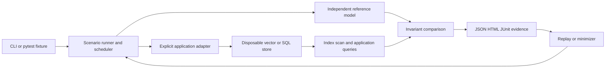

# Architecture

`stores.py` owns real backend behavior. `suite.py` owns the reference model,
synthetic fixture, scheduling events, convergence polling and bounded monitoring.
`discovery.py` uses Hypothesis find/shrinking against real executions.
`product_cli.py` loads validated inputs, runs cases and records execution errors.
`reporting.py` escapes HTML and writes machine-readable evidence.
`pytest_plugin.py` exposes the opt-in runner fixture.

The original `engine.py`, `backends.py` and `cli.py` remain for schema 1 replay
compatibility. New results use schema 2. Reports persist schedules, observations,
reference state history, divergence and settings; they deliberately omit service
credentials. App resources close before store cleanup, including on failure.
